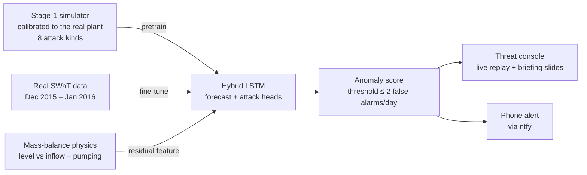

# Stage 1 Threat Console

**Catching cyberattacks on a water treatment plant using physics, a calibrated simulator and an LSTM, then paging the operator's phone.**

Built at **natHacks 2026** (University of Alberta, Nov 6–9) on the **SWaT** dataset, a real six-stage water treatment testbed that researchers attacked 36 times.


---

## At a glance

| | |
| --- | --- |
| **Problem** | Plant alarms often don't catch attacks on water-utility controllers. |
| **Approach** | Mass-balance physics + a simulator-pretrained hybrid LSTM. |
| **Scope** | Stage 1 of SWaT: raw water tank T-101 (FIT101, LIT101, MV101, P101, P102). |
| **Headline result** | Physics alone catches both sensor-spoofing attacks and misses both pump attacks, at 0.7 false alarms/day. |
| **Output** | A single-file operator console with MITRE ATT&CK for ICS tagging and phone alerts via ntfy. |

## Contents

1. [Why this matters](#why-this-matters)
2. [How it works](#how-it-works)
3. [Key finding](#key-finding)
4. [Experiments and results](#experiments-and-results)
5. [Evaluation integrity](#evaluation-integrity)
6. [The simulator](#the-simulator)
7. [The threat console](#the-threat-console)
8. [Quick start](#quick-start)
9. [Repository layout](#repository-layout)
10. [Limitations](#limitations)
11. [Team](#team)
12. [Data and acknowledgements](#data-and-acknowledgements)

---

## Why this matters

Water utilities run on controllers that were never designed to be on the internet, and attackers have noticed.

| Incident | What happened | Why it matters |
| --- | --- | --- |
| **Aliquippa, Pennsylvania** (Nov 25, 2023) | Iran-linked "CyberAv3ngers" took over an internet-exposed Unitronics controller running a **pump that regulates water pressure** for two townships, using the **default password**. | FBI, CISA, NSA, EPA and Israel's National Cyber Directorate issued joint advisory [AA23-335A](https://media.defense.gov/2023/Dec/04/2003350920/-1/-1/0/CSA-IRGC-AFFILIATED-CYBER-ACTORS-EXPLOIT-PLCS-IN-MULTIPLE-SECTORS.PDF): water facilities in *multiple U.S. states* were hit. |
| **Oldsmar, Florida** (Feb 5, 2021) | Remote access to the control system was used to raise sodium hydroxide dosing. | Per [CISA AA21-042A](https://us-cert.cisa.gov/ncas/alerts/aa21-042a), staff corrected it *"before the SCADA system's software detected the manipulation and alarmed."* A former city official later called it employee error; no official findings were released. |

In both cases the plant's own alarms weren't what caught it. CISA's advice is to add **independent cyber-physical checks** that don't trust the control system. That's what this project builds.

---

## How it works

We protect **stage 1** of SWaT, the raw water tank T-101: inlet flow (FIT101), level sensor (LIT101), inlet valve (MV101) and two pumps (P101, P102). It's the same kind of equipment hit in Aliquippa, and SWaT has 10 real attacks on it.



**1. Physics first.** A tank obeys a mass balance: the level should rise with inflow and fall with each running pump. We fit it on real data:

```
dLIT ≈ 0.956·FIT101 − 2.371·pump_on + 0.011    (per 5 s)
```

When the reported level breaks physics, the sensor is lying.

**2. A simulator to learn from.** Real attack data is scarce: only 4 labelled stage-1 attacks to train on. Our simulator generates as many as we want. It is calibrated from real SWaT data and injects 8 attack kinds, each modelled on a real one.

**3. A hybrid LSTM.** Pretrained on the simulator, then fine-tuned on real data with a frozen backbone. It forecasts the next level as *physics prediction + learned correction*, and a second head outputs the attack probability.

**4. An operator console.** It replays the plant, raises incidents tagged with MITRE ATT&CK for ICS techniques, and buzzes phones.

---

## Key finding

The physics check alone, with no ML, **catches both sensor-spoofing attacks and misses both pump attacks**, at **0.7 false alarms per day**.

| Held-out test attack | What the attacker did | Physics check |
| --- | --- | --- |
| #33 | Faked the tank level high | ✅ caught in **50 s** |
| #34 | Switched pump P101 off | ❌ missed |
| #35 | Switched P101 off, kept backup P102 off | ❌ missed |
| #36 | Faked the tank level low | ✅ caught in **65 s** |

The reason is visible in the data:


- **Spoofed sensor:** the reported level (solid) is pulled away from what physics predicts (dashed).
- **Pump switched off by an attacker:** the effect is *physically real*, so the tank genuinely behaves that way and physics agrees.

Catching pump attacks needs a model of what *normal operation* looks like. **That's the LSTM's job, and the question our experiments answer.**

---

## Experiments and results

| Experiment | Training data | Question it answers |
| --- | --- | --- |
| `physics_only` | None (mass balance) | Is ML needed at all? |
| `real_only` | Real SWaT | Baseline LSTM |
| `sim_ft` | Simulator with attacks → real | Does simulator pretraining help? |
| `sim_noanom_ft` | Simulator without attacks → real | Do the *simulated attacks* matter, or just the physics? |
| `sim_only` | Simulator only | How big is the sim-to-real gap? |

**Options**
- `--fractions 0.25 0.5 1.0` repeats each experiment with less labelled real data, to show how much the simulator saves.
- `--seeds 0 1 2` reports mean ± std.

### Results

<!-- Paste results/summary.md here after `python run_experiments.py` -->

| Experiment | Attacks caught (of 4) | Mean delay | False alarms/day | Point-wise F1 | Point-adjusted F1* |
| --- | --- | --- | --- | --- | --- |
| Physics check only | 2 | 58 s | 0.7 | 0.137 | 0.720 |
| LSTM experiments | *run `python run_experiments.py`* | | | | |

\*Point-adjusted F1 counts a whole attack as detected if a single moment is flagged. Many SWaT papers report it, but it inflates results, so we lead with attacks caught, delay and false alarms.

---

## Evaluation integrity

Anomaly detection on SWaT is easy to overstate. We made deliberate choices against that:

- **Split by time and by attack.** Train on attacks #1, #2, #3, #21; tune the threshold on #26 and #30; **test only on #33–#36**, which are never seen in training or tuning.
- **Simulated data is never used for testing.** Every reported number comes from real attacks.
- **The threshold is set the way an operator would set it:** the most sensitive level that keeps validation false alarms at **≤ 2 per day**. With a best-F1 threshold instead, the same detector produced *260* false alarms a day.
- **Out-of-scope attacks are masked, not called "normal".** 26 of SWaT's attacks target other stages, so their rows are excluded rather than mislabelled.
- **Attack-level metrics come first** (caught, delay, false alarms/day). Point-adjusted F1 is labelled as inflated.
- **Dataset quirks are handled:** label typos ("A ttack"), day-first timestamps and 5 hours of tank start-up in the normal data.

---

## The simulator


`simulator.py` runs one tick per second:

1. **PLC logic** acts on the *sensed* level: open the valve at 500 mm, close at 800 mm, stop the pump below 250 mm.
2. **Attacks** override actuators or falsify the sensor.
3. **Physics** updates the true level, including the valve's 8-second travel time.
4. **The sensor** reports, unless it is being spoofed.

Because the PLC trusts the sensor, a spoof has real consequences. A "tank nearly empty" lie makes the PLC open the valve and stop the pump, and the tank overflows, exactly like real attack #36.

### Calibration

Every constant is measured from real SWaT normal operation and randomized ±10% per run (domain randomization). Against 72 h of real data:

| | Real plant | Simulator |
| --- | --- | --- |
| Valve opens / closes at | 499 / 801 mm | 498 / 801 mm |
| Inflow with valve open | 2.55 m³/h | 2.61 m³/h |
| Median pump run / rest | 3126 / 1080 s | 2917 / 1166 s |
| Share of time pump on | 74.5% | 72.2% |

### Attack kinds

| Kind | Modelled on real attacks |
| --- | --- |
| Valve forced open / closed | #1, #21 |
| P101 forced on / off | #26, #30 / #34, #35 |
| Backup pump P102 on | #2 |
| Level spoofed high / low | #33 / #36 |
| Level drift | #3 |

---

## The threat console

A single HTML file: `dashboard/index.html`. No framework, no build step, nothing to install.

### Console mode

Replays the held-out test days at up to 3600× speed.

| Panel | What you see |
| --- | --- |
| **Process view** | Tank T-101 animates live, with a *ghost line* showing where physics says the water should be. During a spoof the two split apart. |
| **Telemetry** | A 2-hour window of level, flow, valve/pump states and the anomaly score against its threshold. |
| **Incidents** | Alarm band, audible alert and incident cards tagged **T0856 Spoof Reporting Message** or **T0855 Unauthorized Command Message** (MITRE ATT&CK for ICS). |
| **Phone alerts** | Every incident is pushed through [ntfy](https://ntfy.sh). Subscribe to a topic in the ntfy app and your phone buzzes. |
| **Ground truth toggle** | Overlays the real attacks so you can see what was caught and what was missed. |

### Briefing mode

The pitch deck, generated from `results.json`, so the slides can never disagree with the results. Use the arrow keys to move between slides.


It covers the question, the train/validation/test timeline, a detector-by-attack matrix with delays, attacks caught vs false alarms, spoof vs pump physics traces, training curves and an honest-metrics slide.

---

## Quick start

**Requirements:** Python 3.10+ and the SWaT dataset (A1, Dec 2015), requested from iTrust, SUTD (Singapore University of Technology and Design).

```bash
pip install -r requirements.txt

# 1. Convert the SWaT Excel files to stage-1 CSVs (once, ~4 min)
python convert_swat.py --swat-dir "path/to/SWaT/Physical" --out data

# 2. Try the simulator (~2 s): CSVs, attack log and a plot in sim_out/
python simulator.py --hours 24 --clean
python check_simulator.py              # compare with the real plant

# 3. Train and evaluate every detector
python run_experiments.py --smoke      # 2-minute check that everything runs
python run_experiments.py              # full run -> results/results.json + summary.md

# 4. Open the console
python -m http.server 8000             # then visit http://localhost:8000/dashboard/
```

> **Demo tip:** pick 900× speed, press **Next incident**, open **Alerts** and send a test push to a phone in the audience.

---

## Repository layout

```
convert_swat.py      SWaT Excel → compact stage-1 CSVs
swat_data.py         loading, attack catalogue, masking, splits, mass balance, windows
simulator.py         calibrated stage-1 simulator + 8 attack kinds + CLI
check_simulator.py   simulator vs real plant, side by side
model.py             hybrid LSTM (backbone, adapter, forecast + attack heads)
evaluate.py          attack-level metrics, false-alarm-budget threshold, F1s
run_experiments.py   all experiments → results/results.json, summary.md
dashboard/           the threat console (one HTML file)
docs/TECHNICAL.md    full technical notes and the results.json schema
```

---

## Limitations

- **Only four test attacks.** One attack changes the score by 25%, so we report per-attack results and multiple seeds.
- **SWaT is a research testbed** in Singapore, not an Alberta utility, and the data is from 2015.
- **One stage, one simplified simulator.** Stage 1 is the cleanest physics in the plant; extending to the RO unit (stage 5) is the natural next step.
- **Simulated attacks are our assumptions about attackers.** That's why we test only on real ones.

---

## Team

| Name | Role |
| --- | --- |
| **Oyonti** | Team lead, evaluation design |
| **Dev** | LSTM model |
| **Zyle** | Data pipeline |
| **Vanya** | Attack synthesis and the simulator |
| **Neila** | Threat console |
| **Ashar** | Research and pitch |

---

## Data and acknowledgements

The SWaT dataset is from iTrust, Centre for Research in Cyber Security, Singapore University of Technology and Design.

**The dataset is not included in this repository.** Its licence doesn't allow redistribution, so request it from iTrust. `data/` is git-ignored, and `results/results.json` contains only derived numbers.

> Goh, J., Adepu, S., Junejo, K. N., & Mathur, A. (2016). *A Dataset to Support Research in the Design of Secure Water Treatment Systems.* CRITIS 2016.
